# End-to-End OpenTelemetry Distributed Tracing across tkati Pipelines

* **Author:** Andrey Tatarinov
* **Date:** 2026-11-10

---

## Context

`tkati` is designed for high-throughput streaming pipelines where data is consumed, processed, and produced in batches of Apache Arrow tables (`pa.Table` / `pa.RecordBatch`), backed by native PyO3 Rust extensions ([`packages/tkati-core/src/`](file:///workspace/packages/tkati-core/src/)) for Kafka consumption and Rayon-parallelized JSON serialization. Worker nodes execute either synchronous loops (`SyncNode`) or overlapped asynchronous delivery loops (`PipelinedNode`) via [`packages/tkati-core/tkati_core/node.py`](file:///workspace/packages/tkati-core/tkati_core/node.py).

While existing instrumentation provides aggregate loop metrics (`LoopStats` Prometheus counters for `consumer/*`, `producer/*`, and loop phase timers), operators have no visibility into the lifecycle of individual events traversing multi-node pipeline graphs:
1. **Broken Trace Context**: Upstream systems passing W3C `traceparent` headers into Kafka have their traces truncated because `tkati-core`'s native consumer discards record headers during polling.
2. **Untraceable End-to-End Latency**: When events experience processing delays across multiple node hops (ingest -> transform -> deduplication -> ClickHouse sink), operators cannot measure per-event stage durations or isolate stage bottlenecks.
3. **Silent Drops in Filtering and Deduplication**: When a record is discarded by [`tkati-node-dedup`](file:///workspace/packages/tkati-node-dedup/src/tkati_node_dedup/main.py) or filtered out in [`tkati-node-el`](file:///workspace/packages/tkati-node-el/src/tkati_node_el/main.py), downstream sinks never see it, and operators cannot verify whether the event was intentionally filtered or lost due to failure.
4. **Volume vs. Overhead Conflict**: High-throughput pipelines process tens of thousands of events per second per node. Creating a Python OpenTelemetry span object for every message introduces excessive GIL contention and serialization overhead.

---

## Goal

### Done when:
* **W3C Header Wire Propagation**: `KafkaConsumer` and `KafkaProducer` in `tkati_core._native` ([`src/kafka.rs`](file:///workspace/packages/tkati-core/src/kafka.rs), [`src/lib.rs`](file:///workspace/packages/tkati-core/src/lib.rs)) extract and inject W3C `traceparent` Kafka record headers without reducing base batch throughput by more than 3%.
* **Sparse In-Memory Correlation**: A nullable `tkati_traceparent` Arrow string column (`pa.string()`) associates trace contexts with specific rows in `pa.Table` batches with under 5 KiB memory overhead per 1,000-row batch.
* **Controlled Head-Based Sampling & Root Span Creation**: Ingest nodes support stride head-sampling (`trace_each_nth`) with a per-batch circuit breaker (`max_spans_per_batch = 16`), physically creating and exporting an `ingest` root span whose W3C `traceparent` populates `tkati_traceparent` while honoring upstream sampled headers (`flags & 0x01 == 1`).
* **Shared Root Parent Across Downstream Hops**: Intermediate processing nodes (`tkati-node-el`, `tkati-node-dedup`) keep `tkati_traceparent` immutable and strictly follow upstream tags without initiating mid-stream sampling, creating chronological child processing spans under the shared root span.
* **Clean Serialization & Terminal Sink Boundaries**: `KafkaProducer` strips `tkati_traceparent` from JSON payloads to populate outbound Kafka record headers. `ClickhouseProducer` strips `tkati_traceparent` inside `_insert_with_retry()` immediately before `insert_arrow()` (preserving it across `_insert_with_dlq_fallback()` so rejected rows routed to the DLQ retain their trace header).
* **Centralized Drop & Failure Observation**: `_NodeBase` detects sampled rows present in the input batch that are absent from `output_arrow` at `_take_batch()`, emitting a `row_dropped` span event and closing those spans with `StatusCode.OK`, while marking uncommitted spans with `StatusCode.ERROR` on batch exception/rewind in `__exit__()`.
* **Synchronous Batch Processing Window**: Processing spans start in `_NodeBase._next_event()` when a batch is yielded and close in `_NodeBase._take_batch()` when `node.done()` completes.

### Non-goals:
* **Full-Stream 100% Tracing**: Tracing every record at 100k+ rows/s is out of scope due to Python runtime and network bandwidth overhead.
* **Automatic Shielding of User Code**: The framework does not automatically strip and re-join `tkati_traceparent` around user transform functions; pipeline authors must preserve the column in their projections.
* **Tracing for `consume_pylist`**: The list-of-dicts consumer interface (`consume_pylist`) does not extract or propagate trace headers.
* **Replacement of Metrics**: Tracing supplements, rather than replaces, `LoopStats` and Prometheus loop phase timers.

---

## Approach

This design bridges batch vectorization and per-event causality by treating trace context as a sparse columnar property owned by the node harness (`_NodeBase`):

1. **Native Rust Header Filtering**: During polling in `KafkaConsumer::poll_step` (`src/kafka.rs`), `librdkafka` message headers are inspected in C/Rust. Only valid 55-byte ASCII W3C `traceparent` headers with the sampled bit set (`flags & 0x01 == 1`) are copied into `RawBatch`; unsampled (`flags = 00`) or malformed headers become `None`, avoiding Python string allocations for untraced messages.
2. **Sparse Arrow Column Correlation**: When `RawBatch` contains sampled headers (or when an ingest node applies stride head-sampling), the batch carries a nullable `tkati_traceparent` column (`pa.string()`). Vectorized table operations (`filter`, `slice`, `take`) in `tkati-node-el` and `tkati-node-dedup` preserve row-to-trace alignment automatically.
3. **Immutable Root Parent & Harness-Owned Lifecycle**: When an ingest node head-samples an untraced row, `_NodeBase._next_event()` starts and ends a physical root span (`f"{service_name} ingest"`) and writes its `00-{trace_id}-{root_span_id}-01` into `tkati_traceparent`. Every processing node in the graph extracts the parent context from `tkati_traceparent`, starts a child span (`f"{service_name} process"`), and keeps `tkati_traceparent` unchanged so all stage spans share the root parent in chronological order. At `_take_batch()`, `_NodeBase` diffs input vs. output `tkati_traceparent` values to emit `row_dropped` events for filtered rows and closes active spans.
4. **Clean Outbound Boundaries**: In `"json"` mode, `KafkaProducer.produce_arrow()` extracts and drops `tkati_traceparent` before `_to_wire_table` and `encode_arrow()`, passing the sparse header list to `NativeProducer.enqueue()`. In `ClickhouseProducer._insert_with_retry()`, `tkati_traceparent` is dropped immediately prior to `insert_arrow()`, keeping the column available if `_insert_with_dlq_fallback()` routes a rejected row to the DLQ `KafkaProducer`.

---

## Design

### Critical User Journeys (CUJs)

#### CUJ 1: End-to-End Traced Event Traversal
* **Given**: An upstream HTTP gateway produces an event to Kafka topic `raw-events` with a W3C `traceparent` header flagged as sampled (`01`).
* **When**: The event passes through `tkati-node-el` (transform), `tkati-node-dedup` (deduplication), and a ClickHouse sink node configured with `ClickhouseProducer`.
* **Then**: Jaeger/Tempo visualizes a single unified trace under the upstream root span displaying the chronological stage child spans (`tkati-node-el process`, `tkati-node-dedup process`, and the ClickHouse sink node's `process` span) with stage durations.

#### CUJ 2: Head Stride Sampling on Ingest
* **Given**: An ingest node consumes untraced events from an external Kafka topic with `trace_each_nth = 1000` and `max_spans_per_batch = 16`.
* **When**: A batch of 2,500 messages is polled and yielded by `_NodeBase._next_event()`.
* **Then**: 2 or 3 events in the batch have physical root spans (`f"{service_name} ingest"`) created and exported, and their W3C `traceparent` strings (`00-{trace_id}-{root_span_id}-01`) are written into the `tkati_traceparent` column to propagate downstream.

#### CUJ 3: Deduplication & Filter Drop Observation
* **Given**: A sampled event with a non-null `tkati_traceparent` is consumed by `tkati-node-dedup` as a duplicate key (or filtered out by `tkati-node-el`).
* **When**: The node filters out the row and passes the surviving table to `node.done(event, output_arrow=filtered)`.
* **Then**: `_NodeBase._take_batch()` detects that the row's `tkati_traceparent` is absent from `output_arrow`, records a `row_dropped` span event on the active span, and closes the span with `StatusCode.OK`.

---

### Architectural Overview & Data Flow

```mermaid
flowchart TD
    subgraph Ingest_Topic ["Kafka Ingest Topic"]
        KMsg["Kafka Messages (Wire)<br/>Payload: JSON<br/>Headers: traceparent"]
    end

    subgraph Processing_Node ["Ingest / Processing Node"]
        NC["KafkaConsumer::poll_step (Rust)<br/>Extracts valid 55-byte sampled (flags & 1)<br/>traceparent headers into RawBatch"]
        Parse["KafkaConsumer.read_arrow()<br/>1. parse_ndjson to pa.Table<br/>2. If any(traceparents): append 'tkati_traceparent'"]
        NextEv["_NodeBase._next_event()<br/>1. Stride head-sampling -> emit root 'ingest' span<br/>2. Start child 'process' span per sampled row"]
        Transform["Node Business Logic<br/>table.filter(...) / transform(...)<br/>Contract: tkati_traceparent preserved"]
        TakeBatch["_NodeBase._take_batch() / __exit__()<br/>1. Diff input vs output_arrow traceparents<br/>2. Missing rows -> emit 'row_dropped' & close OK<br/>3. Surviving rows -> close 'process' span OK"]
        Strip["KafkaProducer.produce_arrow() (json mode)<br/>1. Extract headers from tkati_traceparent<br/>2. data.drop_columns(['tkati_traceparent'])<br/>3. encode_arrow(data) without trace column"]
        NP["NativeProducer.enqueue (Rust)<br/>Enqueues JSON payload with W3C headers"]
    end

    subgraph Intermediate_Topic ["Kafka Intermediate Topic"]
        KOut["Outbound Kafka Topic<br/>Wire payload clean of trace column<br/>Headers carry W3C traceparent"]
    end

    subgraph Sink_Node ["Terminal Sink Node (ClickHouse)"]
        CHConsume["Node consumes batch & starts 'process' span"]
        CHFallback["ClickhouseProducer._insert_with_dlq_fallback()<br/>Preserves tkati_traceparent for DLQ slices"]
        CHRetry["ClickhouseProducer._insert_with_retry()<br/>Drops tkati_traceparent before insert_arrow()"]
        CHDone["Node closes 'process' span on done()<br/>Or DLQ KafkaProducer forwards header on bad row"]
    end

    KMsg --> NC
    NC --> Parse
    Parse --> NextEv
    NextEv --> Transform
    Transform --> TakeBatch
    TakeBatch --> Strip
    Strip --> NP
    NP --> KOut
    KOut --> CHConsume
    CHConsume --> CHFallback
    CHFallback --> CHRetry
    CHRetry --> CHDone
```



---

### Component Details

#### 1. PyO3 Native Extension (`packages/tkati-core/src/`)
* **Header Extraction in `KafkaConsumer::poll_step` ([`src/kafka.rs`](file:///workspace/packages/tkati-core/src/kafka.rs)) and `RawBatch` ([`src/lib.rs`](file:///workspace/packages/tkati-core/src/lib.rs))**:
  * In `KafkaConsumer::poll_step`, inspect `msg.headers()` via `rdkafka::message::{Headers, Message}`. If a `"traceparent"` header is present, is 55 ASCII bytes (`00-{32_hex}-{16_hex}-{2_hex}`), and has the sampled bit set (`flags & 0x01 == 1`), push `Some(String)` to `traceparents: &mut Vec<Option<String>>`; otherwise push `None` (tombstones are omitted to match `payloads`).
  * `RawBatch` in `src/lib.rs` stores `traceparents: Vec<Option<String>>`, exposes `def traceparents(self) -> list[str | None]: ...`, and updates `RawBatch.from_payloads(payloads, traceparents=None)` so broker-free unit tests can construct batches with synthetic headers.
* **Sparse Header Enqueueing in `KafkaProducer::enqueue` ([`src/kafka.rs`](file:///workspace/packages/tkati-core/src/kafka.rs)) and `NativeProducer` ([`src/lib.rs`](file:///workspace/packages/tkati-core/src/lib.rs))**:
  * `EncodedBatch` and `encode_arrow` remain unchanged.
  * `NativeProducer.enqueue(self, batch: EncodedBatch, tag: int = 0, headers: Sequence[str | None] | None = None) -> None` accepts an optional sequence of `traceparent` strings matching `len(batch)` (raising `ValueError` if `len(headers) != len(batch)`).
  * In `KafkaProducer::enqueue`, when `traceparents` contains `Some(tp)` for message `i`, attach `OwnedHeaders::new().insert(Header { key: "traceparent", value: Some(tp.as_bytes()) })` to `BaseRecord`. Unsampled messages (`None`) allocate no `OwnedHeaders` in `librdkafka`.

#### 2. Vectorized In-Memory Representation (`packages/tkati-core/tkati_core/`)
* **Column Attachment in [`KafkaConsumer.read_arrow()`](file:///workspace/packages/tkati-core/tkati_core/kafka/consumer.py)**:
  * After `parse_ndjson` deserializes the wire JSON into `table: pa.Table`, inspect `tps = raw_batch.traceparents()`.
  * If `any(tps)` is true, construct `trace_array = pa.array(tps, type=pa.string())` and append it via `table = table.append_column("tkati_traceparent", trace_array)`. If no message in the batch carries a sampled header, return `table` unmodified so untraced pipelines and existing schema tests incur zero schema changes.
* **Arrow Memory Layout**:
  * A `pa.string()` column consists of a validity bitmap (`ceil(N / 8)` bytes, 1 bit per row), a 32-bit offset buffer (`(N + 1) * 4` bytes), and the contiguous ASCII data buffer (`55` bytes per sampled row).
  * For a 1,000-row batch with 2 sampled rows, the `tkati_traceparent` column occupies `125 + 4,004 + 110 = 4,239` bytes (~4.2 KiB).

#### 3. Outbound Serialization Boundaries
* **Kafka Outbound ([`KafkaProducer.produce_arrow()`](file:///workspace/packages/tkati-core/tkati_core/kafka/producer.py))**:
  * In `self.format == "json"` mode, before calling `_to_wire_table(data, self.wire_type_overrides)` and `_serialize_arrow()`, check if `"tkati_traceparent"` is in `data.schema.names`:
    ```python
    headers: list[str | None] | None = None
    if "tkati_traceparent" in data.schema.names:
        headers = data.column("tkati_traceparent").to_pylist()
        data = data.drop_columns(["tkati_traceparent"])
    ```
  * Using `data.drop_columns(["tkati_traceparent"])` works identically on both `pa.Table` and `pa.RecordBatch` as a metadata-only operation. The clean `data` is passed to `_to_wire_table` and `encode_arrow()`, and `headers` is passed to `self.producer.enqueue(messages, tag or 0, headers=headers)`.
  * In `self.format == "arrow-batch"` mode (where the entire table is serialized as a single Arrow IPC stream message), `"tkati_traceparent"` is kept inside the Arrow IPC table and `headers=None` is passed to `enqueue`.
* **ClickHouse Outbound ([`ClickhouseProducer`](file:///workspace/packages/tkati-core/tkati_core/clickhouse/producer.py))**:
  * `ClickhouseProducer.produce_arrow()` and `_insert_with_dlq_fallback()` leave `"tkati_traceparent"` attached to `data` while slicing batches via `_table_slices()`.
  * Inside `_insert_with_retry()`, strip `"tkati_traceparent"` via `arrow_table = arrow_table.drop_columns(["tkati_traceparent"])` immediately before calling `self.client.insert_arrow()`, preventing ClickHouse error code 16 (`NO_SUCH_COLUMN_IN_TABLE`).
  * If a single bad row is isolated in `_insert_with_dlq_fallback()` (`len(table) == 1`) and sent to `dlq_producer.produce_arrow(table)`, the row still carries its `"tkati_traceparent"` column, which the DLQ `KafkaProducer` extracts into the DLQ Kafka record header.

#### 4. Node Lifecycle & Span Management ([`packages/tkati-core/tkati_core/node.py`](file:///workspace/packages/tkati-core/tkati_core/node.py))
* **Head Stride Sampling & Span Initialization in `_NodeBase._next_event()`**:
  * `_NodeBase` holds `self._tracing: TracingSettings`, `self._tracer: Tracer | None`, `self._rows_seen: int = 0`, and `self._active_spans: dict[str, list[Span]] = {}`.
  * When `self._tracing.enabled` is `True` and `_next_event()` reads a `ConsumedBatch[pa.Table]`:
    1. Extract existing `tps: list[str | None]` from `table.column("tkati_traceparent").to_pylist()` if the column exists, else `[None] * len(table)`.
    2. If `self._tracing.trace_each_nth > 0`, for each row `i` where `tps[i] is None` and `(self._rows_seen + i) % self._tracing.trace_each_nth == 0` (up to `self._tracing.max_spans_per_batch` total active spans in the batch):
       * Start and immediately end a root span `self._tracer.start_span(name=f"{service_name} ingest")`.
       * Format that root span's context via `TraceContextTextMapPropagator().inject(...)` into `tps[i]`.
    3. Increment `self._rows_seen += len(table)`. If new traceparents were generated, attach or replace `"tkati_traceparent"` on `table` using `pa.array(tps, type=pa.string())`.
    4. For each non-null `tp` in `tps` (capped at `self._tracing.max_spans_per_batch`), parse the parent context via `TraceContextTextMapPropagator().extract({"traceparent": tp})`, start a child span `self._tracer.start_span(name=f"{service_name} process", context=parent_ctx)`, and append it to `self._active_spans[tp]`.
* **Drop Detection & Settlement in `_NodeBase._take_batch()` and `__exit__()`**:
  * In `_NodeBase._take_batch(event, output_arrow=..., ...)`:
    * Count the surviving non-null `"tkati_traceparent"` values in `output_arrow` (if `output_arrow` is provided and contains `"tkati_traceparent"`, else 0).
    * For each `tp, spans` in `self._active_spans`:
      * Any excess spans beyond the surviving count in `output_arrow` represent rows filtered/dropped by the node (e.g., duplicates in `tkati-node-dedup` or filtered rows in `tkati-node-el`). Record `span.add_event("row_dropped")`, set `StatusCode.OK`, and call `span.end()`.
      * For all surviving spans, set `StatusCode.OK` and call `span.end()`.
    * Clear `self._active_spans`.
  * In `_NodeBase.__exit__(exc_type, exc_val, exc_tb)`:
    * If `self._active_spans` is non-empty when exiting (due to an unhandled exception triggering rewind or an early `break`), record the exception (`span.record_exception(exc_val)`, `span.set_status(StatusCode.ERROR)` when `exc_val is not None`), call `span.end()` on all remaining spans, and clear `self._active_spans`.

#### 5. Configuration Model ([`packages/tkati-core/tkati_core/settings.py`](file:///workspace/packages/tkati-core/tkati_core/settings.py))
* `TracingSettings(BaseModel)` is added to `settings.py` and attached to `NodeSettings` as `tracing: TracingSettings = TracingSettings()`:
  ```toml
  [tracing]
  enabled = true
  service_name = "tkati-node-dedup"
  trace_each_nth = 1000        # Stride for head sampling (0 disables head sampling)
  max_spans_per_batch = 16     # Circuit breaker capping active spans per batch
  ```
* Standard OpenTelemetry environment variables (`OTEL_EXPORTER_OTLP_ENDPOINT`, `OTEL_SERVICE_NAME`) configure the OTLP exporter. `service_name` resolves from `settings.tracing.service_name`, falling back to `OTEL_SERVICE_NAME`, then `"tkati-node"`.

---

### Alternatives Considered

#### Alternative A: Payload Column vs. Kafka Record Headers for Wire Carrier
* **Pros**: Requires no changes to the native Rust Kafka consumer/producer or `librdkafka` bindings; payload fields deserialize directly with PyArrow's JSON parser.
* **Cons**: Pollutes topic business schemas, forces ClickHouse tables to declare dummy tracing columns, and breaks downstream consumers that enforce strict schema validation.
* **Reason for Rejection**: Wire contracts must remain clean and decoupled from infrastructure telemetry. Standard W3C distributed tracing in Kafka relies on record headers.

#### Alternative B: Coarse-Grained Batch Tracing Only (No Row Tracking)
* **Pros**: One span per poll/done iteration with zero Arrow column modifications and zero row-level overhead.
* **Cons**: Fails to correlate individual business records across multi-stage pipelines where batches are split, merged, filtered, or re-grouped across partitions. Cannot identify which node dropped or delayed a specific event.
* **Reason for Rejection**: End-to-end event tracing requires record-level correlation across the pipeline graph.

#### Alternative C: Full 100% Event Tracing
* **Pros**: Every message is traced, providing complete visibility without sampling gaps.
* **Cons**: Python OpenTelemetry SDK span creation, GIL locking, and OTLP network transmission for 100,000+ events per second would reduce node throughput by more than 80% and overwhelm trace backends.
* **Reason for Rejection**: Sparse head sampling (0–4 spans per batch, capped at `max_spans_per_batch = 16`) verifies causal paths across hops within the 3% throughput budget.

#### Alternative D: Out-of-Band Sidecar Mappings for Row Correlation
* **Pros**: Keeps `pa.Table` free of internal tracing columns.
* **Cons**: Requires custom sidecar index tracking that must be recomputed whenever tables are filtered, sliced, sorted, or partitioned in user code.
* **Reason for Rejection**: Storing `tkati_traceparent` as a native Arrow column uses Arrow's built-in `filter` and `take` operations to maintain row-to-trace alignment automatically.

#### Alternative E: Automatic Harness Shielding of `tkati_traceparent` around Transforms
* **Pros**: Insulates user code from the presence of `tkati_traceparent`.
* **Cons**: Stripping the column before user transforms and re-joining it by row index adds harness complexity and fails whenever transforms filter or reorder rows.
* **Reason for Rejection**: Requiring user transforms to preserve `tkati_traceparent` keeps the execution harness simple and explicit.

#### Alternative F: Deferred Delivery Settlement for `PipelinedNode` Spans
* **Pros**: Links span completion to broker acknowledgment and `after_commit` callbacks.
* **Cons**: Includes variable queue wait and network transmission latency inside the node processing span.
* **Reason for Rejection**: Ending the span at `node.done()` (`_take_batch()`) captures the synchronous batch processing window directly.

---

### Non-Functional Requirements

#### Performance & Latency
* **Throughput Gate**: Wire header inspection and column attachment must not reduce base batch throughput by more than 3% under `bench_kafka_json.py`.
* **Memory Footprint**: The nullable Arrow `tkati_traceparent` column must not exceed 5 KiB per 1,000 rows (`125` bytes validity bitmap + `4,004` bytes 32-bit offset buffer + `55` bytes per sampled traceparent = ~4.2 KiB).
* **Non-Blocking Telemetry**: The OpenTelemetry tracer uses `BatchSpanProcessor` with background worker queueing so network export delays do not block the loop thread.

#### Reliability & Backward Compatibility
* **Schema Protection**: `KafkaProducer` (in `"json"` mode) and `ClickhouseProducer` (in `_insert_with_retry()`) strip `tkati_traceparent` before payload encoding and ClickHouse insertion, preventing `NO_SUCH_COLUMN_IN_TABLE` errors.
* **Disabled Mode**: When `[tracing]` is omitted or `enabled = false`, `_NodeBase` operates in no-op mode without initializing a tracer or creating span objects, while `KafkaConsumer` and `KafkaProducer` still transparently pass through any upstream sampled `traceparent` headers.

---

## Risks & Mitigations

| Risk / Failure Mode | Impact | Mitigation |
| :--- | :--- | :--- |
| **Upstream Sampling Flood / DoS**: An upstream service sets `flags = 01` (sampled) on 100% of messages, or sends 100% unsampled (`flags = 00`) headers. | Creating thousands of Python `Span` objects per batch stalls the worker loop and violates the 3% throughput gate. | `KafkaConsumer::poll_step` ignores headers where `flags & 0x01 == 0` (leaving those rows `None`), and `_NodeBase._next_event()` enforces `max_spans_per_batch = 16` per batch. |
| **Malformed / Untrusted W3C Headers**: External Kafka producers send non-ASCII, truncated, or oversized `"traceparent"` headers. | Parser exceptions in Python or memory bloat in `RawBatch`. | Rust `KafkaConsumer::poll_step` validates that `"traceparent"` is exactly 55 ASCII bytes (`00-` prefix, hex segments, `-` delimiters) before allocation; invalid headers are ignored as `None`. |
| **Sensitive Data / PII Leakage in Spans**: Attaching raw business keys or payload columns to span events leaks PII into telemetry backends. | Security and compliance violation in Jaeger/Tempo storage. | `_NodeBase` records only structural metadata (`row_dropped` event, node service name) and never attaches payload columns or deduplication keys to spans. |
| **OTLP Collector Outage / Backpressure**: The telemetry collector becomes unreachable or slow. | Unbounded memory growth or blocked worker loop threads. | `BatchSpanProcessor` uses a bounded in-memory ring buffer (default 2,048 spans) that drops spans when full without blocking the caller thread. |

---

## Implementation Steps

### Phase 1: Native Rust & PyO3 Header Bindings (`packages/tkati-core/src/`)

#### 1. [`packages/tkati-core/src/kafka.rs`](file:///workspace/packages/tkati-core/src/kafka.rs) (Modify)
* Import `rdkafka::message::{Header, Headers, Message, OwnedHeaders}`.
* Add a helper `extract_sampled_traceparent(msg: &BorrowedMessage<'_>) -> Option<String>` that scans `msg.headers()` for key `"traceparent"`, validates that the value is 55 ASCII bytes (`00-{32 lowercase hex}-{16 lowercase hex}-{2 lowercase hex}`) with `flags & 0x01 == 1`, and returns `Some(String)` (or `None` if absent, malformed, or unsampled).
* Update `KafkaConsumer::poll_step` signature to accept `traceparents: &mut Vec<Option<String>>` and push `extract_sampled_traceparent(&msg)` for every non-tombstone message alongside `payloads.push(bytes)`.
* Update `KafkaProducer::enqueue` signature to `pub fn enqueue(&self, messages: &Messages, tag: usize, traceparents: Option<&[Option<String>]>) -> Result<(), KafkaError>`. When `traceparents` provides `Some(tp)` at index `i`, attach `OwnedHeaders::new().insert(Header { key: "traceparent", value: Some(tp.as_bytes()) })` to `BaseRecord`.

#### 2. [`packages/tkati-core/src/lib.rs`](file:///workspace/packages/tkati-core/src/lib.rs) (Modify)
* Add `traceparents: Vec<Option<String>>` field to `RawBatch`.
* Update `RawBatch::from_payloads` to `#[pyo3(signature = (payloads, traceparents=None))]` so broker-free unit tests can supply optional traceparents (defaulting to `vec![None; count]` for non-tombstone payloads, raising `PyValueError` if lengths mismatch).
* Add `fn traceparents(&self) -> Vec<Option<String>>` method to `RawBatch`.
* In `NativeConsumer::poll_batch`, pass `&mut traceparents` into `self.inner.poll_step(...)` and store it in the returned `RawBatch`.
* Update `NativeProducer::enqueue` to `#[pyo3(signature = (batch, tag=0, headers=None))]` accepting `headers: Option<Vec<Option<String>>>`. Validate that if `headers` is `Some(ref h)`, `h.len() == batch.messages.len()` (else raise `PyValueError`), and pass `headers.as_deref()` to `self.inner.enqueue(...)`.

#### 3. [`packages/tkati-core/tkati_core/_native.pyi`](file:///workspace/packages/tkati-core/tkati_core/_native.pyi) (Modify)
* Update `RawBatch.from_payloads` to `def from_payloads(payloads: Sequence[bytes | None], traceparents: Sequence[str | None] | None = None) -> RawBatch: ...`.
* Add `def traceparents(self) -> list[str | None]: ...` to `RawBatch`.
* Update `NativeProducer.enqueue` to `def enqueue(self, batch: EncodedBatch, tag: int = 0, headers: Sequence[str | None] | None = None) -> None: ...`.

* **Phase 1 Checkpoint**: `cargo fmt --check`, `cargo clippy --all-targets -- -D warnings`, and `cargo test` in `packages/tkati-core/` pass.

---

### Phase 2: Python Consumer, Producer, and ClickHouse Column Handling (`packages/tkati-core/`)

#### 4. [`packages/tkati-core/tkati_core/kafka/consumer.py`](file:///workspace/packages/tkati-core/tkati_core/kafka/consumer.py) (Modify)
* Define constant `TRACEPARENT_COLUMN = "tkati_traceparent"`.
* In `KafkaConsumer.read_arrow()`, after decoding `data: pa.Table`, inspect `tps = raw.traceparents()` (for `"json"` format; for `"arrow-batch"` format, if `tps` has a single non-null header and `TRACEPARENT_COLUMN` is not already in `data.schema.names`, populate accordingly). When `any(tps)` is true and `len(tps) == len(data)`, append the column via `data = data.append_column(TRACEPARENT_COLUMN, pa.array(tps, type=pa.string()))`. When `any(tps)` is false, return `data` without adding `tkati_traceparent`.

#### 5. [`packages/tkati-core/tkati_core/kafka/producer.py`](file:///workspace/packages/tkati-core/tkati_core/kafka/producer.py) (Modify)
* In `KafkaProducer.produce_arrow()`, inside the `if self.format == "json":` branch, before calling `_to_wire_table(data, self.wire_type_overrides)`:
  * Check `if "tkati_traceparent" in data.schema.names:`.
  * Extract `headers = data.column("tkati_traceparent").to_pylist()` and strip the column via `data = data.drop_columns(["tkati_traceparent"])`.
  * Pass `headers=headers` to `self.producer.enqueue(messages, tag or 0, headers=headers)`.
* In the `elif self.format == "arrow-batch":` branch, leave `data` intact so `"tkati_traceparent"` is preserved inside the Arrow IPC stream, and call `self.producer.enqueue(messages, tag or 0)`.

#### 6. [`packages/tkati-core/tkati_core/clickhouse/producer.py`](file:///workspace/packages/tkati-core/tkati_core/clickhouse/producer.py) (Modify)
* In `ClickhouseProducer._insert_with_retry()`, check `if "tkati_traceparent" in arrow_table.schema.names:` and drop it via `arrow_table = arrow_table.drop_columns(["tkati_traceparent"])` immediately before calling `self.client.insert_arrow(...)`.
* Leave `ClickhouseProducer.produce_arrow()` and `_insert_with_dlq_fallback()` unmodified so `"tkati_traceparent"` remains attached during `_table_slices()` bisection and is forwarded to `dlq_producer.produce_arrow(table)` when bad rows are isolated.

* **Phase 2 Checkpoint**: Existing `uv run pytest packages/tkati-core/` and `uv run ty check packages/tkati-core` pass with zero regressions.

---

### Phase 3: Settings, `_NodeBase` Span Lifecycle, Documentation, and Tests

#### 7. [`packages/tkati-core/pyproject.toml`](file:///workspace/packages/tkati-core/pyproject.toml) (Modify)
* Add `opentelemetry-api>=1.20.0` and `opentelemetry-sdk>=1.20.0` to `dependencies`, and add `opentelemetry-exporter-otlp-proto-grpc>=1.20.0` under `[project.optional-dependencies]` (`tracing = ["opentelemetry-exporter-otlp-proto-grpc>=1.20.0"]`).

#### 8. [`packages/tkati-core/tkati_core/settings.py`](file:///workspace/packages/tkati-core/tkati_core/settings.py) (Modify)
* Define `class TracingSettings(BaseModel):` with fields:
  * `enabled: bool = False`
  * `service_name: str | None = None`
  * `trace_each_nth: int = 0`
  * `max_spans_per_batch: int = 16`
  * Validate via `@field_validator("trace_each_nth")` that `trace_each_nth >= 0` and via `@field_validator("max_spans_per_batch")` that `max_spans_per_batch >= 1`.
* Add `tracing: TracingSettings = TracingSettings()` to `NodeSettings`.

#### 9. [`packages/tkati-core/tkati_core/node.py`](file:///workspace/packages/tkati-core/tkati_core/node.py) (Modify)
* Add `tracing: TracingSettings = TracingSettings()` parameter to `_NodeBase.__init__`, `SyncNode.__init__`, and `PipelinedNode.__init__`, and pass `tracing=settings.tracing` in `_NodeBase.from_settings()`.
* Add a helper `_init_tracer(tracing: TracingSettings) -> Tracer | None` that returns `None` when `not tracing.enabled`. When `tracing.enabled` is `True`, it resolves `service_name` (`tracing.service_name or os.environ.get("OTEL_SERVICE_NAME") or "tkati-node"`), configures a `TracerProvider` with `BatchSpanProcessor(OTLPSpanExporter())` if `OTEL_EXPORTER_OTLP_ENDPOINT` is set (and no custom provider with active processors was already registered by tests), and returns `trace.get_tracer("tkati", ...)`.
* In `_NodeBase._next_event()`:
  * When yielding a `Batch` whose `data` is a `pa.Table` and `self._tracer is not None`:
    1. Read `tps: list[str | None]` from `data.column("tkati_traceparent").to_pylist()` if `"tkati_traceparent"` is in `data.schema.names`, else `[None] * len(data)`.
    2. Count existing non-null entries in `tps`. If `self._tracing.trace_each_nth > 0`, iterate over rows `i` where `tps[i] is None` and `(self._rows_seen + i) % self._tracing.trace_each_nth == 0` while total sampled rows in the batch `< self._tracing.max_spans_per_batch`:
       * Start and immediately end a root span `self._tracer.start_span(f"{self._service_name} ingest")`.
       * Inject its W3C `traceparent` string via `TraceContextTextMapPropagator().inject(...)` into `tps[i]`.
    3. Advance `self._rows_seen += len(data)`. If `"tkati_traceparent"` was created or updated, attach/replace the column on `data` using `pa.array(tps, type=pa.string())`.
    4. For up to `self._tracing.max_spans_per_batch` non-null `tp` values in `tps`, extract `parent_ctx = TraceContextTextMapPropagator().extract({"traceparent": tp})`, start a child span `self._tracer.start_span(f"{self._service_name} process", context=parent_ctx)`, and append it to `self._active_spans.setdefault(tp, [])`.
* In `_NodeBase._take_batch()`:
  * When `self._active_spans` is non-empty:
    * Count how many times each non-null `tp` appears in `output_arrow.column("tkati_traceparent").to_pylist()` (if `output_arrow is not None` and `"tkati_traceparent"` is in `output_arrow.schema.names`, else `{}`).
    * For each `tp, spans` in `self._active_spans.items()`:
      * Keep `surviving = surviving_counts.get(tp, 0)`.
      * For `span` in `spans[:surviving]`: set `span.set_status(StatusCode.OK)` and call `span.end()`.
      * For `span` in `spans[surviving:]`: call `span.add_event("row_dropped")`, set `span.set_status(StatusCode.OK)`, and call `span.end()`.
    * Clear `self._active_spans`.
* In `_NodeBase.__exit__(exc_type, exc_val, exc_tb)`:
  * If `self._active_spans` is non-empty, iterate over all remaining spans: if `exc_val is not None`, call `span.record_exception(exc_val)` and `span.set_status(StatusCode.ERROR, str(exc_val))`; call `span.end()`; then clear `self._active_spans`.

#### 10. [`packages/tkati-core/README.md`](file:///workspace/packages/tkati-core/README.md) (Modify)
* Add a `## Distributed Tracing` section documenting the `[tracing]` settings table, W3C `traceparent` header propagation, the `tkati_traceparent` column preservation requirement for user transforms, and OTLP environment variables.

#### 11. `packages/tkati-core/tests/test_tracing.py` (Create)
* Test `RawBatch.from_payloads` with `traceparents` and `KafkaConsumer.read_arrow()` conditional attachment of `tkati_traceparent`.
* Test `KafkaProducer.produce_arrow()` stripping `tkati_traceparent` from JSON payloads while forwarding headers to `NativeProducer`, and preserving `tkati_traceparent` in `"arrow-batch"` mode.
* Test `ClickhouseProducer` stripping `tkati_traceparent` inside `_insert_with_retry()` while preserving it for `dlq_producer` on single-row DLQ fallback.
* Test `_NodeBase` head stride sampling (`trace_each_nth`), physical root `ingest` span creation, shared root parent across multi-node hops, `max_spans_per_batch` cap, `row_dropped` span event on filtered rows, and `StatusCode.ERROR` span closure on exception rewind using `InMemorySpanExporter`.

#### 12. `packages/tkati-node-dedup/tests/test_tracing_dedup.py` (Create)
* Test an end-to-end `tkati-node-dedup` batch containing sampled unique and duplicate rows with `InMemorySpanExporter`, verifying that surviving rows keep their `tkati_traceparent` column and dropped duplicate rows emit the `row_dropped` span event and close with `StatusCode.OK`.

* **Phase 3 Checkpoint**: All unit tests, type checks, and lint checks pass across the workspace.

---

## Verification

* **Compilation & Environment Sync**: Run `uv sync --all-packages` to rebuild `tkati_core._native` and update `uv.lock`.
* **Rust Checks**: In `packages/tkati-core/`, run `cargo fmt --check`, `cargo clippy --all-targets -- -D warnings`, and `cargo test`.
* **Static Analysis & Type Checking**: Run `uv run ruff check packages/` and `uv run ty check packages/`.
* **Unit & Integration Tests**: Run `uv run pytest packages/tkati-core/tests/test_tracing.py`, `uv run pytest packages/tkati-node-dedup/tests/test_tracing_dedup.py`, and `uv run pytest packages/`.
* **Performance Benchmark Gate**: Run `uv run python packages/tkati-core/benchmarks/bench_kafka_json.py` to confirm less than 3% throughput delta.
